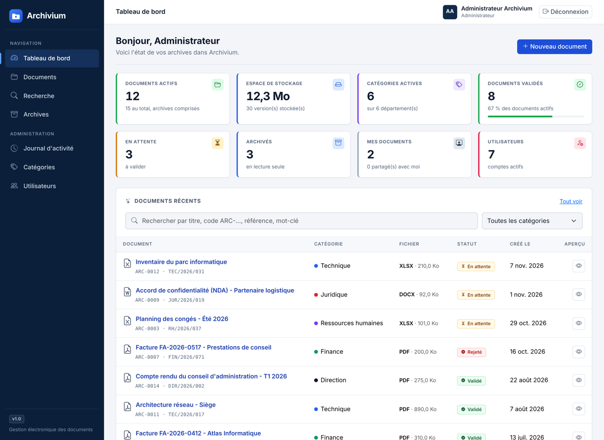
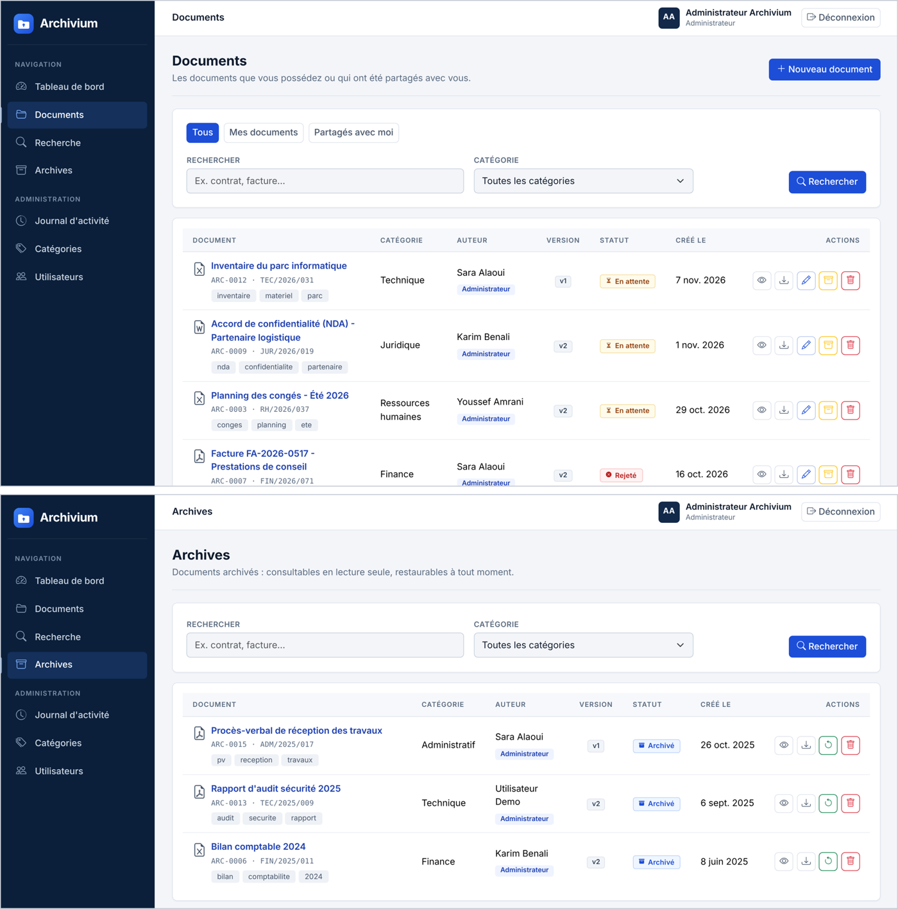
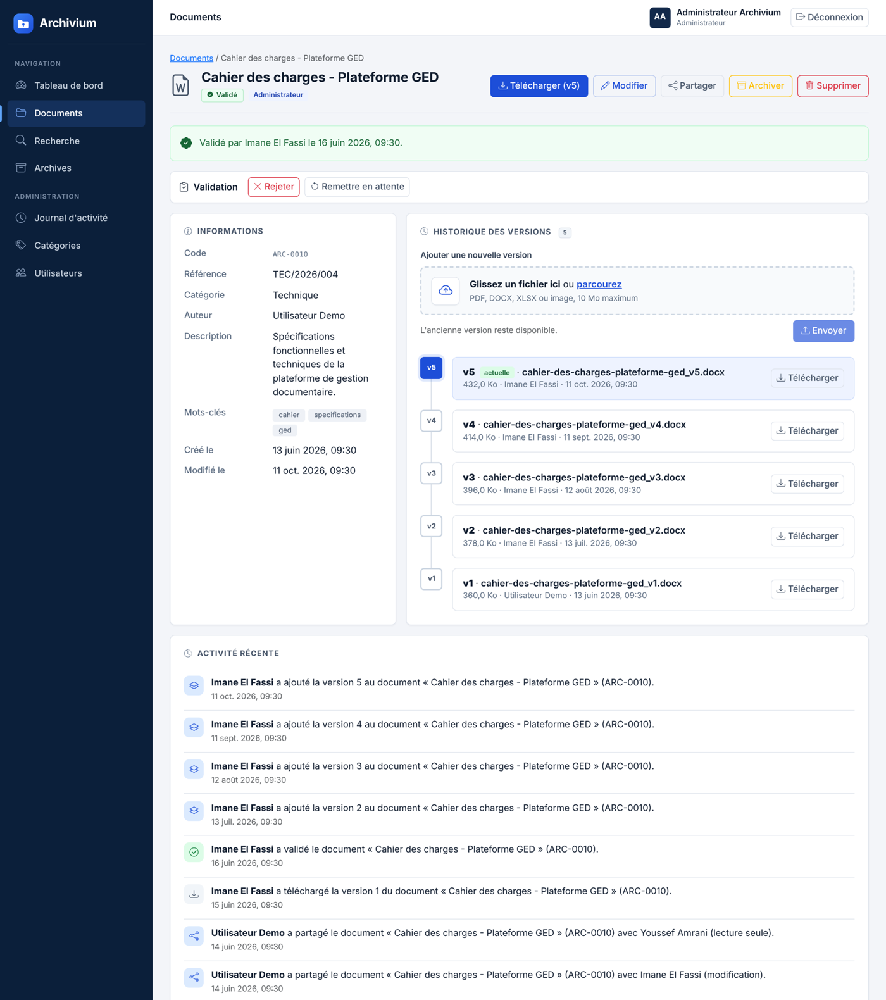
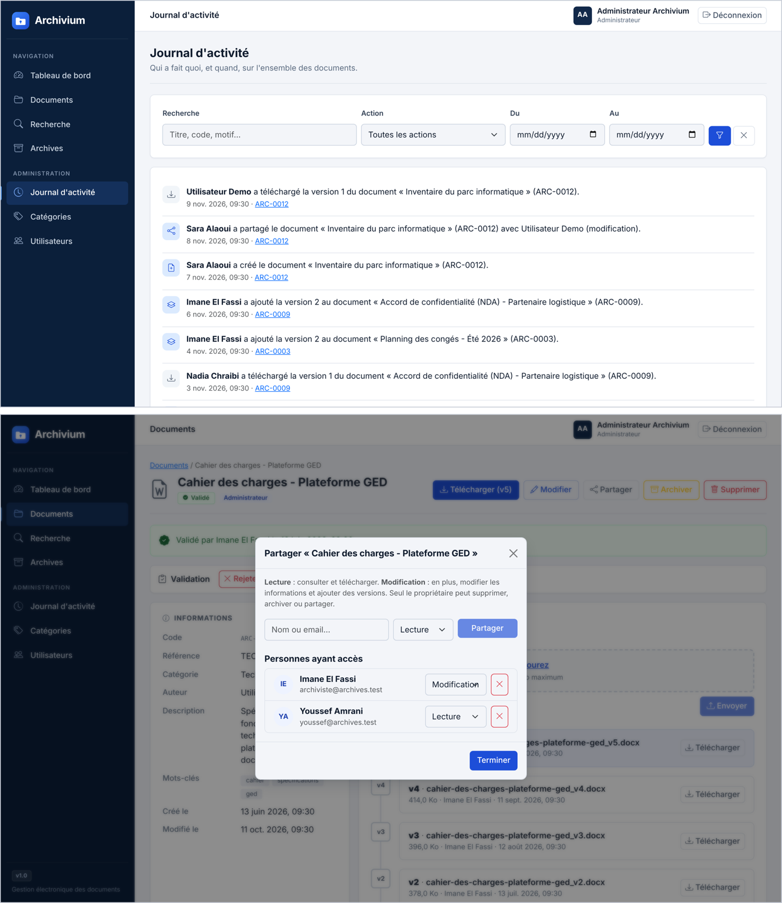

# Archivium

**Plateforme de gestion électronique des archives numériques** : classez, versionnez, validez, partagez et archivez vos documents en toute sécurité.

Projet n°65 du module *Programmation Web Dynamique* (S5, Ingénierie Logicielle), Faculté des Sciences d'Agadir, Université Ibn Zohr. Réalisé par **TALIB Wiame**.

   

## Aperçu

| Tableau de bord | Documents et archives |
| --- | --- |
|  |  |
| **Fiche document et versions** | **Journal d'activité et partage** |
|  |  |

## Fonctionnalités

- Authentification par jeton (Laravel Sanctum) : inscription, connexion, déconnexion.
- Documents avec fichier (PDF, DOCX, XLSX, images, 10 Mo maximum), code unique `ARC-XXXX` et référence interne.
- **Versionnement sans écrasement** (v1, v2, v3…), numérotation sûre en cas d'envois simultanés.
- Téléchargement sécurisé : fichiers sur disque privé, accès après contrôle des droits.
- Recherche multicritère paginée (texte, titre, mots-clés, catégorie, auteur, dates, statut, validation).
- Partage granulaire en **lecture** ou en **modification**.
- **Circuit de validation** (En attente, Validé, Rejeté avec motif) tenu par les archivistes.
- Archivage en lecture seule et restauration.
- **Journal d'activité** global (archivistes, administrateurs) et historique par document.
- Tableau de bord : 8 indicateurs dynamiques, recherche rapide, filtre par catégorie.
- Administration des catégories et des utilisateurs, profil (nom, email, mot de passe).

## Architecture

```
Archivium/
├── backend/    # Laravel 13 : API REST, Sanctum, Policies, migrations, seeders, tests
├── frontend/   # React 18 + Vite : Axios, React Router, Bootstrap 5
└── README.md
```

Deux programmes indépendants qui échangent du JSON en HTTP. Toutes les règles de sécurité sont dans l'API (Policies et FormRequests) ; le frontend ne fait que masquer des boutons.

## Installation

**Prérequis** : PHP 8.3+ (extensions `pdo_mysql`, `mbstring`, `fileinfo`, `zip`, `openssl`), Composer, MySQL 8, Node.js 20+.

Créer la base une fois : `archives_numeriques`, interclassement `utf8mb4_unicode_ci`.

**Backend**

```bash
cd backend
composer install
cp .env.example .env        # puis régler DB_USERNAME / DB_PASSWORD
php artisan key:generate
php artisan migrate:fresh --seed
php artisan serve           # http://localhost:8000
```

**Frontend**

```bash
cd frontend
npm install
npm run dev                 # http://localhost:5173
```

Dans `php.ini`, régler `upload_max_filesize = 12M` et `post_max_size = 12M` (limite PHP par défaut : 2 Mo).

## Comptes de démonstration

Mot de passe de tous les comptes : `password`.

| Email | Rôle |
| --- | --- |
| `admin@archives.test` | Administrateur |
| `archiviste@archives.test`, `karim@archives.test` | Archiviste |
| `user@archives.test` | Utilisateur |
| `sara@archives.test`, `youssef@archives.test`, `nadia@archives.test` | Utilisateur |

Le seeder crée 7 comptes, 6 catégories et 15 documents avec versions, partages et journal d'activité.

## Tests

```bash
cd backend
php artisan test
```

Tests fonctionnels Laravel sur SQLite en mémoire : authentification, catégories, documents, administration, champs d'archivage, circuit de validation, profil et journal d'activité.

## Droits d'accès

| Action | Propriétaire / Admin | Partage « modification » | Partage « lecture » |
| --- | --- | --- | --- |
| Voir, télécharger | Oui | Oui | Oui |
| Modifier, ajouter une version | Oui, si non archivé | Oui, si non archivé | Non |
| Supprimer, partager, archiver | Oui | Non | Non |

Les archivistes peuvent en plus valider, rejeter, rouvrir, archiver et restaurer tout document, et consulter le journal d'activité.

## Licence

Projet académique.
